# SpeakReady - Mermaid Architecture Diagrams

Copy and paste these diagrams into any Mermaid-compatible viewer:
- https://mermaid.live
- GitHub (in .md files)
- Notion
- VSCode (with Mermaid extension)

---

## 1. High-Level System Architecture

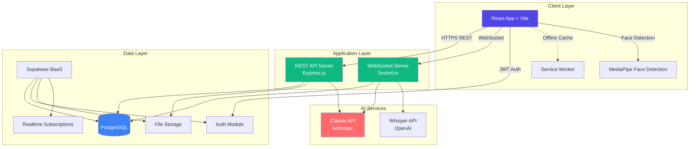

---

## 2. Complete Interview Flow

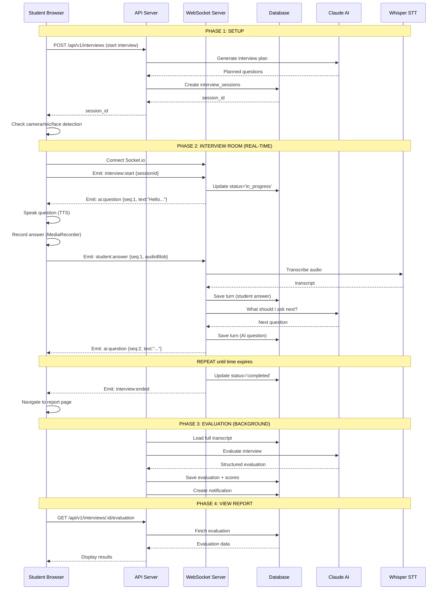

---

## 3. Database Schema (Entity Relationship)

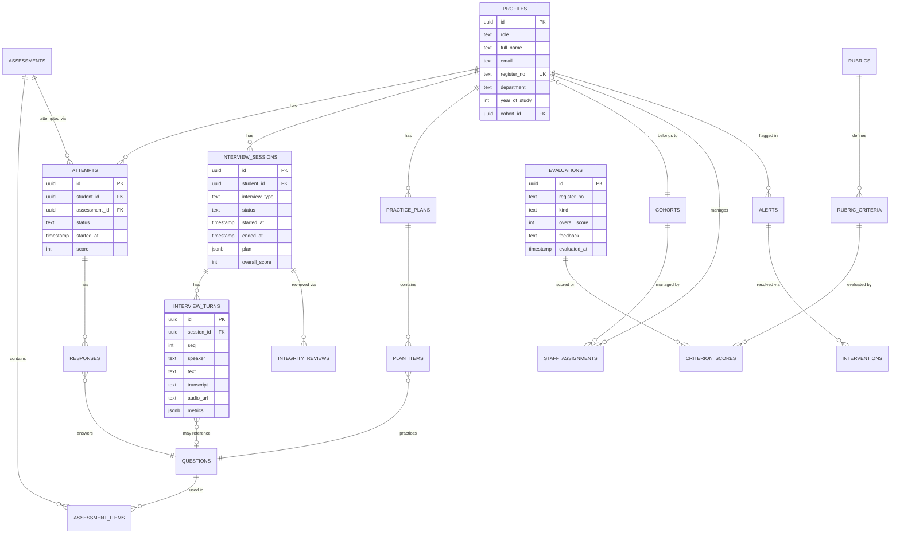

---

## 4. Frontend Component Architecture

```mermaid
graph TB
    subgraph "Entry Point"
        Main[main.tsx<br/>App Entry]
        App[App.tsx<br/>Root Router]
    end
    
    subgraph "Context Providers"
        AuthProvider[AuthProvider<br/>User Session]
    end
    
    subgraph "Layout"
        Layout[Layout.tsx<br/>Nav + Header]
    end
    
    subgraph "Student Pages"
        Dashboard[Dashboard.tsx]
        Practice[Practice.tsx]
        History[History.tsx]
        InterviewSetup[InterviewSetup.tsx]
        InterviewRoom[InterviewRoom.tsx<br/>WebSocket]
        InterviewReport[InterviewReport.tsx]
    end
    
    subgraph "Staff Pages"
        StaffDash[Staff.tsx]
        Integrity[Integrity.tsx]
        Questions[Questions.tsx]
        Reports[Reports.tsx]
    end
    
    subgraph "Admin Pages"
        AdminPage[Admin.tsx<br/>Users/Rubrics/System]
    end
    
    subgraph "Shared Components"
        UI[ui.tsx<br/>Button/Card/Modal]
        Scores[Scores.tsx]
        RouterProgress[RouterProgress.tsx]
    end
    
    subgraph "Core Libraries"
        API[api.ts<br/>Fetch Wrapper]
        Auth[auth.tsx<br/>useAuth Hook]
        Supabase[supabase.ts]
        Socket[socket.ts<br/>Socket.io Client]
        RoutePreload[route-preload.ts]
    end
    
    Main --> App
    App --> AuthProvider
    AuthProvider --> Layout
    Layout --> Dashboard
    Layout --> StaffDash
    Layout --> AdminPage
    
    Dashboard --> Practice
    Dashboard --> InterviewSetup
    InterviewSetup --> InterviewRoom
    InterviewRoom --> InterviewReport
    
    InterviewRoom --> Socket
    Dashboard --> API
    StaffDash --> API
    AdminPage --> API
    
    API --> Auth
    Auth --> Supabase
    
    Layout --> UI
    Dashboard --> UI
    Dashboard --> Scores
    
    style InterviewRoom fill:#FF6B6B,color:#fff
    style Socket fill:#FF6B6B,color:#fff
    style AuthProvider fill:#10B981,color:#fff
```

---

## 5. Backend Module Architecture

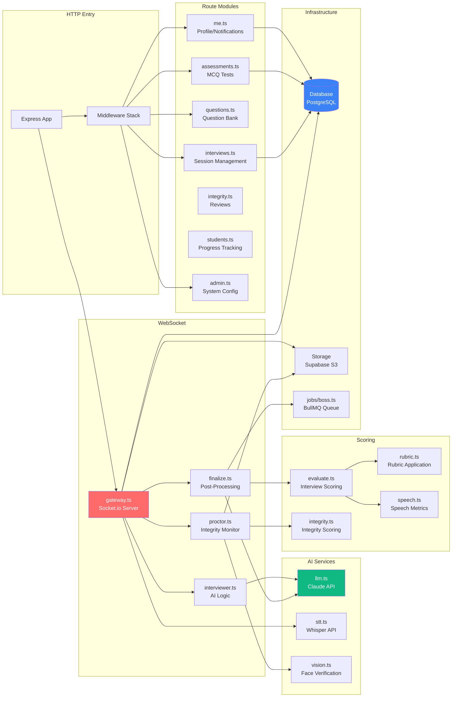

---

## 6. Authentication & Authorization Flow

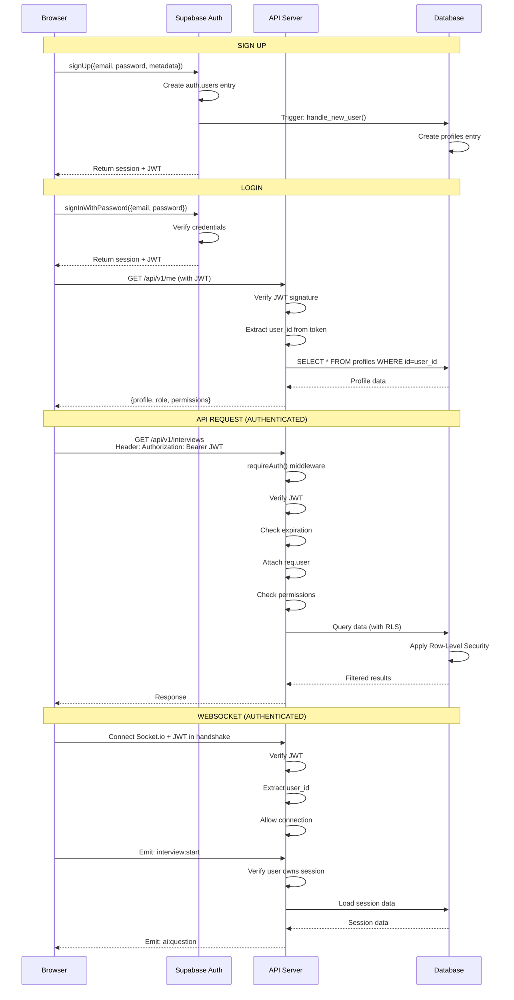

---

## 7. Interview Room Real-time Flow

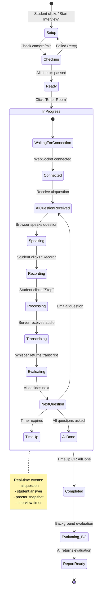

---

## 8. Data Flow - Student Journey

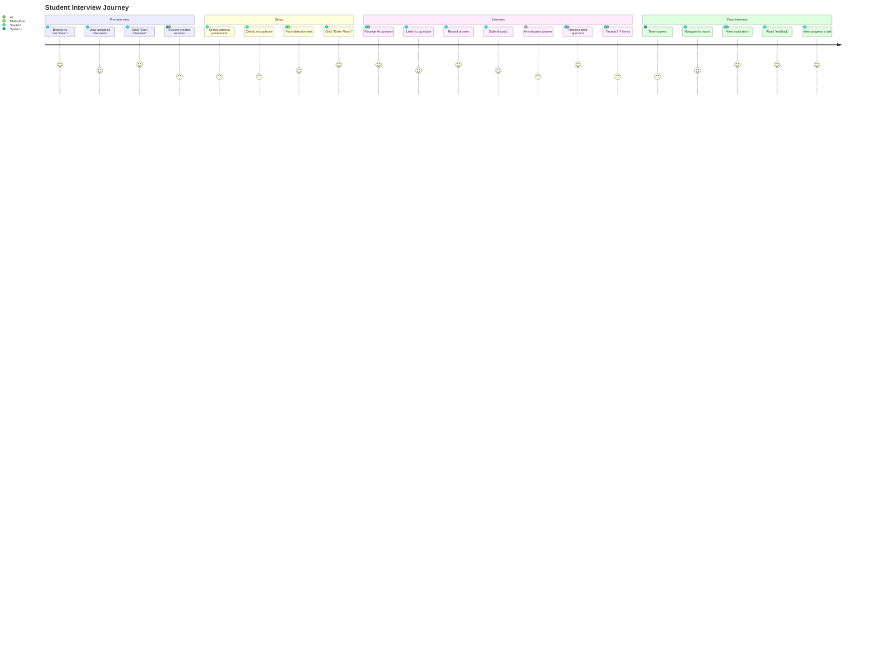

---

## 9. Deployment Architecture

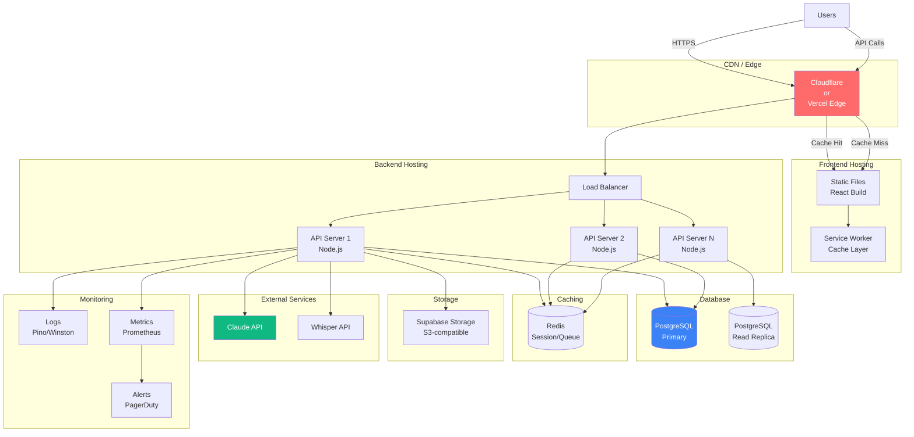

---

## 10. CI/CD Pipeline

```mermaid
graph LR
    subgraph "Development"
        Dev[Developer<br/>Local Machine]
        Git[Git Commit]
    end
    
    subgraph "Version Control"
        GitHub[GitHub<br/>Repository]
    end
    
    subgraph "CI Pipeline"
        Test[Run Tests<br/>Jest/Vitest]
        Lint[Lint Code<br/>ESLint]
        TypeCheck[Type Check<br/>TypeScript]
        Build[Build<br/>Vite/TSC]
    end
    
    subgraph "CD Pipeline"
        Deploy[Deploy to<br/>Staging]
        E2E[E2E Tests<br/>Playwright]
        Prod[Deploy to<br/>Production]
    end
    
    subgraph "Monitoring"
        Health[Health Checks]
        Rollback[Auto Rollback<br/>on Errors]
    end
    
    Dev --> Git
    Git --> GitHub
    GitHub -->|Push to main| Test
    Test --> Lint
    Lint --> TypeCheck
    TypeCheck --> Build
    Build -->|Success| Deploy
    Deploy --> E2E
    E2E -->|Pass| Prod
    Prod --> Health
    Health -->|Fail| Rollback
    
    style GitHub fill:#4F46E5,color:#fff
    style Build fill:#10B981,color:#fff
    style Prod fill:#FF6B6B,color:#fff
```

---

## 11. Microservices Vision (Future)

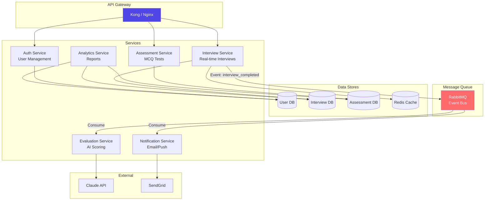

---

## 12. Security Architecture

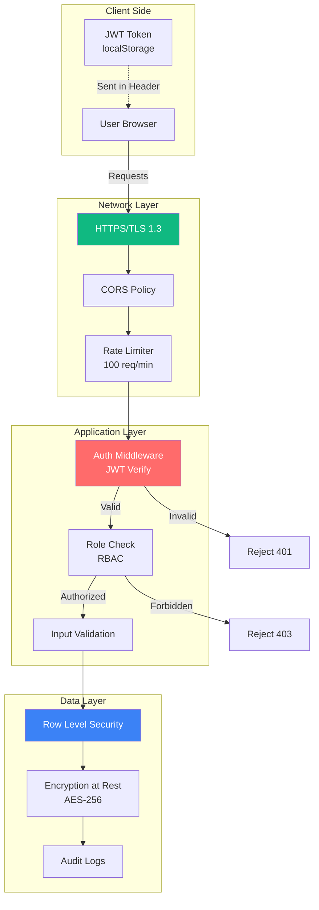

---

## How to Use These Diagrams

### 1. View Online
- Go to https://mermaid.live
- Copy any diagram code above
- Paste into editor
- Export as PNG/SVG

### 2. In GitHub
- Create or edit a `.md` file
- Paste diagram inside code fence with `mermaid` language:
  ````markdown
  ```mermaid
  graph TB
    A --> B
  ```
  ````
- GitHub automatically renders it

### 3. In VS Code
- Install "Markdown Preview Mermaid Support" extension
- Open this file
- Press `Ctrl+Shift+V` (preview mode)
- Diagrams render automatically

### 4. Export for Presentations
1. Open in https://mermaid.live
2. Click "Actions" → "Export"
3. Choose PNG (high resolution) or SVG
4. Use in PowerPoint/Google Slides

---

## Customization Tips

### Change Colors
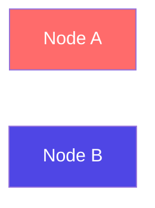

### Add Icons (with FontAwesome)
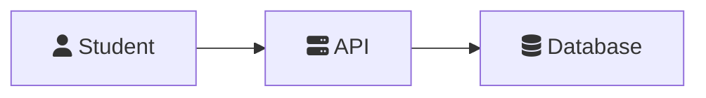

### Adjust Layout Direction
- `TB` = Top to Bottom
- `LR` = Left to Right
- `BT` = Bottom to Top
- `RL` = Right to Left

Example:
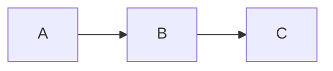

---

**END OF MERMAID DIAGRAMS**

All diagrams are copy-paste ready and can be rendered in:
- Mermaid Live Editor
- GitHub/GitLab
- Notion
- Confluence
- VS Code
- Obsidian
- Draw.io (with plugin)
